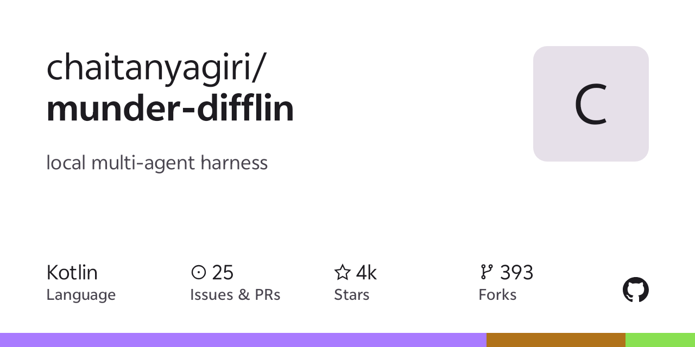
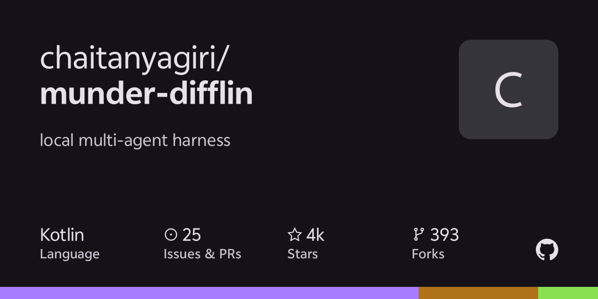

# GitHub OG 风格原生卡片

2026-11-20，延续 [Token 与原生卡片](github-token-native-cards-20261120.md) 的开发实现。目标为 GitHub 默认仓库 Social Preview 的构图和信息层级；聊天内使用 Compose，分享和相册使用固定尺寸 PNG。

## 构图

| 区域 | 实现 |
| --- | --- |
| 画布 | 正常字号的聊天卡片以 2:1 为最小构图；预览、分享和相册统一使用 1280×640。 |
| 标题 | 左上显示 owner/repo，owner 使用常规字重、repo 加粗；保留自然换行和末尾省略。 |
| 简介 | 标题下方使用次级文字颜色，保留主要留白区域。私有、归档和派生状态仍可显示。 |
| 头像 | 右上圆角方形大头像，约占画布宽度的 1/6；缺图或离线时显示所有者首字母。 |
| 统计 | 底部为图标、数据、标签的分层统计，显示 Language、Issues & PRs、Stars 和 Forks，右侧为项目已内置的 GitHub 标识。 |
| 语言条 | 底部全宽色条，根据语言 API 返回的真实代码字节数计算比例，合计使用 Double 避免 Long 溢出。 |
| 字号 | 聊天内跟随手机字号；大字体下统计改为两列、卡片增高。标准 PNG 使用固定逻辑字号以维持 OG 构图。 |

参考图的主要区域按归一化坐标对齐：标题左边距约 6.7%W，头像位于约 76.7%W / 13.3%H，语言条占底部约 4%H。内容不同不宜用像素相似度百分比代替实际构图检查。

## 数据与交互

- 原仓库响应新增读取 `open_issues_count`。GitHub 此字段包含开放的 Issue 和 PR，因此标签使用 `Issues & PRs`。
- 新版卡片按需增加一次 `GET /repos/{owner}/{repo}/languages`。其值为各语言代码字节数，不是行数或文件数；匿名公开数据和具备 Metadata read 权限的私有数据使用相同接口。
- 仓库信息先显示，语言数据随后补充；语言失败、限流或预算不足时保留已有卡片，色条回退为主要语言的单色强调条，不声明比例。
- 语言请求与元数据共用串行队列、Token 身份、持久化预算及服务端冷却。成功结果保留 30 分钟，失败保留 5 分钟；私有语言数据仅进入当前凭据的内存缓存。
- 预览、分享和保存从当前元数据快照绘制，不再请求 API。头像仅使用现有图片缓存，导出不发起新头像网络请求。
- 短按跳转、三项长按菜单及正文选择隔离继续生效，常规设置可切回原有卡片。

## 验证

本机 37 项相关 JVM 测试通过；vivo V2301A / Android 16 上使用独立 Debug 包完成 4 项真机测试，全部通过。未修改正式版与常用 QA 的聊天数据或凭据。

| 检查 | 结果 |
| --- | --- |
| 构建 | 主 Debug APK、AndroidTest APK 构建成功，使用既有 D 盘共享构建资源。 |
| 结构和外观 | 已逐图检查深浅色导出及聊天截图：左上标题与简介、右上头像、底部统计和标识、全宽语言条的层级与参考 OG 构图相近。 |
| 窄屏布局 | 真机发现并修复统计末项因宽度舍入意外换行、统计与简介重叠的问题；统计改为按列权重布局，上下区域按实际高度测量。 |
| 大字体 | 长仓库名和长简介在 1.0、1.6、2.0 字号下，标题与头像、简介与统计、统计与语言条边界均无重叠。大字体允许卡片增高。 |
| 标准图片 | 深浅色导出及实际保存相册的 PNG 均为不透明 1280×640，可解码。 |
| 语言条 | Kotlin / Java / Shell 的 700:200:100 夹具，在底部横截面精确得到 896 / 256 / 128 像素，与 70% / 20% / 10% 一致。 |
| 交互 | 正文选择容器内短按、三项长按菜单、生成图片预览、相册保存、系统分享选择器正常；未选择接收方。预览及导出未增加 API 调用。 |
| 接口 | 手机真实匿名读取本仓库元数据和语言，各一次请求；Room 缓存及订阅一致，第二次读取未增加请求。 |
| 凭据 | 真机 Keystore 加解密、密钥不可导出、密钥缺失时拒绝读取通过；合成 Token 设置保存、移除与官网按钮通过。 |

真机结束后已清理合成凭据、测试相册和分享文件，并将临时亮屏配置恢复为原值 `0`。构建报告、完整测试输出和原始截图位于忽略的 `build/reports/github-cards-20261120/`；像素核验 JSON 与参考图并排对照位于 `build/reports/github-social-preview-20261120/`。原始用户参考图未加入发布资源。

浅色标准导出（合成仓库数据与首字母头像）：

深色标准导出：

结论：当前原生实现达到与默认 GitHub Social Preview 相近的构图和信息层级，支持移动端自适应及标准尺寸图片；不宣称像素复刻。字体、主题色、换行和统计字段会存在差别。没有可靠来源的 Contributors、Discussions 数值不显示；真实个人 Token / 私有仓库尚未联调，仓库自定义社交封面不在本次原生默认卡片构图范围内。

## 官方依据

- [社交预览图片规范](https://docs.github.com/en/repositories/managing-your-repositorys-settings-and-features/customizing-your-repository/customizing-your-repositorys-social-media-preview)：至少 640×320，最佳显示推荐 1280×640。
- [语言接口](https://docs.github.com/en/rest/repos/repos#list-repository-languages)：响应值为语言字节数，fine-grained Token 需要 Metadata read，公开仓库支持匿名访问。

以上规范经 AnySearch 与 Tavily 读取核对。构图还参考了用户提供的仓库 OG 示例，原参考图片仅保留作本地对照。
