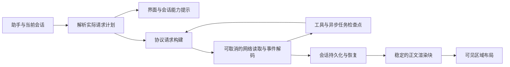

# 模块审阅与后续开发方向（2026-11-15）

建议下一阶段围绕三条主线推进：**请求与任务执行的一致性、长会话的内存和渲染、供应商协议的持续维护**。其中，图片任务重试和搜索能力判断已有本机复现证据，应先于大范围模块搬迁处理；OpenAI 官方语音接口迁移有明确截止日期，需要同步安排。

## 1. 范围与审阅依据

覆盖 Android 的 `app`、`ai`、`common`、`document`、`highlight`、`material3`、`search`、`speech`、`web`、`workspace`，以及 `app:baselineprofile`、`web-ui`、`build-logic`、`trace-cli`、`locale-tui` 和 CI。沿用本次项目工作的范围，排除 `desktop`／`desktopApp`。

这是模块级架构、关键执行路径、接口契约、资源生命周期、测试和可维护性审阅，并非对所有源码逐行穷尽验证。预编译原生库进行了 ELF 和 APK 对齐检查，没有在本轮重做原生库源码审计或供应商收费接口测试。

- 本地 HEAD：`7302fc3db40d63d33c46ffeb8755b3d03e77d4a5`；审阅对象包含当前未提交、未跟踪的工作区代码，不能仅用该提交号重建本次状态。
- 关键源码快照：`build/reports/module-review-20261115/reviewed-source-snapshot.json`，记录 1095 个主源码文件的 SHA-256；该数量是留存快照范围，不表示逐行验证了 1095 个文件。
- 模块清单：同目录 `inventory.json`。其中源码统计包含 Kotlin、构建脚本、TypeScript、Python 和 C/C++，排除了构建目录、依赖目录和 MCU 子模块；不是完整第三方代码行数统计。
- 外部材料：通过 AnySearch 检索并读取官方开发文档与固定上游快照，摘录见同目录 `sources-snapshot.json`。正文抓取失败的资料单独标注。
- 本轮证据分为：**本机复现**、**静态调用链**、**当天既有真机工件**。三者不相互替代。

## 2. 优先处理的问题

### F1 · P1：图片任务轮询断网可能再次提交创建请求

**证据：本机 HTTP 模拟服务复现。** 创建接口先返回 `task_id`，第一次状态查询主动断开连接；按当前外层重试方式重新收集生成 Flow 后，模拟服务收到了 **两次创建 POST**。没有调用真实供应商，也没有下载模拟结果 URL。

调用链：

- [ImgGenVM.kt](../app/src/main/java/me/rerere/rikkahub/ui/pages/imggen/ImgGenVM.kt)：`collectImageGenerationWithRetry()` 的重试边界是 `!receivedFinalImage`。
- [OpenAIProvider.kt](../ai/src/main/java/me/rerere/ai/provider/providers/openai/OpenAIProvider.kt)：媒体接口的冷 Flow 每次收集都会调用 `LingkeMediaImageAPI.generate()`。
- [LingkeMediaImageAPI.kt](../ai/src/main/java/me/rerere/ai/provider/providers/openai/LingkeMediaImageAPI.kt)：先创建任务，再在函数局部变量中保存任务 ID 并轮询。轮询 IOException 向外传播，任务 ID 没有进入可恢复的任务记录。

因此，“尚未收到最终图片”不能作为“创建请求可以安全重放”的判断依据。最终图片下载失败、应用进程终止后的恢复也应按同一原则处理；本轮动态复现覆盖的是轮询断网。

**建议：**拆开创建、轮询、下载三个阶段，取得任务 ID 后立即持久化；网络恢复后重试原任务的状态查询／下载。创建结果未知时显示明确状态，避免自动重发付费创建请求。可直接借鉴已有 [VideoGenerationWorker.kt](../app/src/main/java/me/rerere/rikkahub/data/video/VideoGenerationWorker.kt) 的任务状态和 `creation_result_unknown` 处理。

验收用例：轮询断网、结果下载失败、后台回收后恢复均保持同一任务 ID；已知任务场景创建 POST 恰为一次。供应商没有提供幂等保证时，不承诺网络故障下恰好执行一次。

### F2 · P1：搜索能力判断与实际协议自动路由不一致

**证据：本机 JVM 复现。** 对同一个官方 OpenAI `gpt-6.1-sol`、`useResponseApi=false`、启用 Search 的配置：

- `shouldUseResponsesApi()` 返回 `true`；
- `supportsNativeWebSearch()` 返回 `false`。

[OpenAIModelCompatibility.kt](../ai/src/main/java/me/rerere/ai/provider/providers/openai/OpenAIModelCompatibility.kt) 已正确实现官方 GPT-6 自动路由至 Responses；[ToolCapabilities.kt](../ai/src/main/java/me/rerere/ai/provider/ToolCapabilities.kt) 却只依据保存的开关判断 OpenAI 原生搜索。[SearchAvailability.kt](../app/src/main/java/me/rerere/rikkahub/data/datastore/SearchAvailability.kt) 据此选择外接搜索、生成会话能力提示，而 [ResponseAPI.kt](../ai/src/main/java/me/rerere/ai/provider/providers/openai/ResponseAPI.kt) 仍会按模型的 Search 标记声明 `web_search`。

这会造成界面、会话提示与真实工具声明不一致，并可能同时声明外接和原生搜索。**本轮没有证明模型一定重复调用或一定重复计费。**

**建议：**先解析唯一的请求计划，再由界面、会话能力提示、工具注册和序列化共同使用。计划至少包含实际协议、模型身份、已验证能力、有效参数和实际声明的工具。保留第三方中转用户显式选择的协议，不因模型名称统一强制切换。

验收：官方／第三方 × Chat／Responses × 名称别名 × 搜索开关的矩阵中，提示、UI 与抓取到的请求 JSON 一致。

### F3 · P1：原始内容日志绕过统一日志开关和脱敏流程

**证据：静态调用链。** [ResponseAPI.kt](../ai/src/main/java/me/rerere/ai/provider/providers/openai/ResponseAPI.kt) 仍直接记录完整请求 JSON、完整非流式响应与 SSE 数据；[ChatCompletionsAPI.kt](../ai/src/main/java/me/rerere/ai/provider/providers/openai/ChatCompletionsAPI.kt) 也保留完整请求／事件日志。这些调用没有经过 `Logging.isRequestLoggingEnabled()`，与已有 [RequestLoggingInterceptor.kt](../app/src/main/java/me/rerere/rikkahub/data/ai/RequestLoggingInterceptor.kt) 的统一记录和脱敏边界分离。

至少在 Debug／QA 路径，即使关闭应用内详细请求日志，提示词、正文、工具参数或媒体数据仍可能进入系统日志。拼接和序列化大型内容本身也会增加 CPU 与分配开销。本轮没有导出真实用户正文验证泄露，也没有把此结论扩大为“密钥必然泄露”。

**建议：**统一使用结构化诊断，默认记录请求 ID、协议、耗时、状态、长度和错误类别。详细正文仅走已有明确开关与脱敏边界，错误响应也按同样规则处理。为日志关闭与详细日志两种模式增加合成标记测试。

### F4 · P1：长消息的惰性布局粒度仍然过大

**证据：当天真机压力工件加当前源码。** [ChatList.kt](../app/src/main/java/me/rerere/rikkahub/ui/pages/chat/ChatList.kt) 以整条消息作为惰性列表项；[MarkdownNew.kt](../app/src/main/java/me/rerere/rikkahub/ui/components/richtext/MarkdownNew.kt) 内部仍用 Column 挂载整条回复的全部块。每帧追加 32 块降低了峰值，但最终仍会组合和测量视口外内容。

当天最终 14.9 万字符、五条复制消息的结果：流式最长主线程帧从 2100 ms 降到 234 ms，复制滑动最长帧从 1850 ms 降到 578 ms；复制滑动 P95 却从 36 ms 变为 250 ms。详见 [渲染压力测试报告](render-stress-hydrogen-carbon-minimax-20261115.md)。这些是先前同日采集的数据，本轮审阅没有再次操作手机采集。

另外，[ConversationRepository.kt](../app/src/main/java/me/rerere/rikkahub/data/repository/ConversationRepository.kt) 的 `loadMessageNodes()` 虽分批读取数据库，最终仍把全部节点及分支解码到列表。数据库分批读取尚不等于可见历史消息窗口化。

**建议：**先为超长回复构建稳定的块表示，将正文、代码、表格和图形块作为可见区域加载的单位；再考虑长会话的节点窗口。正常短消息路径保持简单。块 ID、滚动锚点、分支切换、流式追加、头像和操作栏应有共同契约。

跨块文字选择需要专门设计；完整复制／导出可以继续使用完整内容和离屏渲染。不能通过截断正文、隐藏渲染器、移除必要的 Google 搜索建议或放弃导出完整性换取性能数字。

验收先要求跨消息 P95 恢复到原基线附近，再按设备帧预算继续优化；同时覆盖首次进入、热缓存、停止生成、键盘弹出、主题切换和低内存恢复，区分生产性能构建与 Debug 数值。

### F5 · P2：文档解析诊断字符串会被当成正常内容

**证据：本机无效 DOCX 复现。** `DocxParser.parse()` 对非 OOXML 文件返回普通非空字符串 `Unable to find document content in DOCX file`。

[KnowledgeDocumentImporter.kt](../app/src/main/java/me/rerere/rikkahub/data/knowledge/KnowledgeDocumentImporter.kt) 的后续检查是非空与长度；[DocumentAsPromptTransformer.kt](../app/src/main/java/me/rerere/rikkahub/data/ai/transformers/DocumentAsPromptTransformer.kt) 的错误缓存排除仅识别 `[ERROR,` 前缀。该诊断文字能通过这两类检查。复现未执行嵌入请求；“可进入后续分块／提示词处理”由调用链确认。

**建议：**解析层返回明确的成功／失败／截断结果，调用方不再猜测字符串前缀。错误文档不进入嵌入、索引或成功缓存；给用户显示可重试的解析原因。

### F6 · P1：文档解析的内存与原生资源预算不完整

**证据：静态路径，尚未进行本轮大文档 OOM 复现。**

- [PdfParser.kt](../document/src/main/java/me/rerere/document/PdfParser.kt) 未显式释放 Document、Page、StructuredText；仓库内 MuPDF Java 包装均提供 `destroy()`，当前代码依赖最终回收器释放原生资源。
- PDF／DOCX／PPTX／EPUB 多数返回完整 String；知识库的 300 万字符检查发生在完整解析之后，无法限制解析过程的峰值。
- [XlsxParser.kt](../document/src/main/java/me/rerere/document/XlsxParser.kt) 已有单个共享字符串和最终输出上限，但共享字符串总数／总量仍会累积。
- 文档提示词缓存只按 16 个条目限制，没有总字符／字节预算；普通附件路径也没有复用知识库的全部输入上限。

**建议：**统一解析预算：输入大小、解压总量、页数、提取字符总量、取消检查及缓存权重。在 finally 中按依赖顺序释放 MuPDF 对象，按页或块输出。沿用已有 WorkManager 导入恢复机制，不把资源控制仅放在 UI 或完成之后。

### F7 · P1（有截止日期）：OpenAI 官方 TTS 需要协议迁移

OpenAI 官方 [TTS 文档](https://developers.openai.com/api/docs/guides/text-to-speech) 与 [弃用公告](https://developers.openai.com/api/docs/deprecations) 均列出：`tts-1`、`tts-1-hd`、`gpt-4o-mini-tts` 于 **2027-01-06** 停用，迁移目标为 Realtime API 的 `gpt-realtime-2.1-mini`。

当前 [OpenAITTSProvider.kt](../speech/src/main/java/me/rerere/tts/provider/providers/OpenAITTSProvider.kt) 使用 `/audio/speech`；默认设置和语音模型目录仍包含上述模型。官方特别说明替代模型不适用于原 Speech endpoint，因此不能仅替换字符串。

**建议：**新增 Realtime TTS 传输适配，保留兼容供应商现有 Speech API 路径；按实际供应商和协议显示迁移信息。复用现有播放状态、流式 PCM 背压和取消机制，补齐会话、音频增量、结束、错误与断线事件测试。应在截止日前完成迁移及真机回归。

### F8 · P2：工作区测试夹具与 rootfs 安装契约不一致

**证据：本轮常规测试失败。** `ExampleUnitTest.rootfsInstallerDownloadsAndExtractsTarGz` 的压缩包只含 `bin/hello`，而 [RootfsInstaller.kt](../workspace/src/main/java/me/rerere/workspace/RootfsInstaller.kt) 明确要求 `bin/sh`。44 项测试中 1 失败、4 因 Windows 环境跳过。

**建议：**补齐测试夹具的合法 shell 入口，保留安装器校验；在 Linux CI 与 Android ARM64 上执行命令、取消、后代进程持有管道及流采集线程退出测试。这里没有把测试失败解释为真机安装器已经损坏。

## 3. 各模块判断

| 模块／领域 | 当前值得保留的实现 | 后续重点 |
| --- | --- | --- |
| app：会话与存储 | AcceptedTurn 提前显示／持久化屏障、任务版本保护、会话级锁、Room 分批读取和全文搜索分页 | 先固定发送／停止／恢复不丢消息的契约；再将 ChatService 中请求计划、任务执行和后处理分离。长会话窗口化需保留分支及引用语义。 |
| app：渲染 | 后台解析、稳定 HTML 块复用、稳定选择容器、图形诊断、导出就绪检查 | F4 的块级虚拟化；统一 Markdown AST／HTML 的块表示。Google 搜索建议目前直接创建 WebView，应纳入统一的可见性与资源预算，同时保留官方展示要求。 |
| app：设置与外观 | MCU 取色、HCT 对比度搜索、前景按实际表面修正、磁盘分析缓存与深色回归测试 | 合并预览／正式页使用的规则；针对复杂明暗图与 ROM 建立固定截图集。饱和度与字重不能保证所有混合背景都达到同一对比度；按采样覆盖率验证，遵守已确定的无描边方案。 |
| app：知识库／记忆 | 128 条分批精确 top-k、模型元数据隔离、WorkManager 导入、可恢复分块 | F5/F6；大库使用精确扫描作为召回基准，再评估 FTS／向量索引，避免重新引入候选数量硬截断造成漏召回。 |
| app：图像／视频 | 图像参数约束、临时文件清理；视频已有任务实体、后台 Worker 与创建结果未知状态 | F1；让异步图像任务复用视频已验证的任务恢复原则，区分创建／查询／下载的重试权限。 |
| app：MCP／工具 | 会话生命周期 Mutex、配置变更重连、OAuth 状态、工具执行审批和检查点 | 把工具声明、实际执行和持久化检查点纳入统一请求／事件契约；增加断连、审批与取消竞态回放。 |
| ai | 已拆分协议 decoder、保留供应商思考／签名元数据、名称识别不改请求 ID、参数家族与协议清理 | F2/F3；将实际路由、能力、参数和工具生成统一。回调 SSE 使用无界队列虽避免丢 delta，仍需评估有背压的读取实现；工具事件不能简单合并丢弃。 |
| common | `awaitAndUse` 覆盖响应体取消、原子日志存储、有界日志持久化 | 让媒体轮询和自定义 JS fetch 等路径统一使用取消／体积预算。旧 `sseFlow` 保留了未检查的 trySend；当前主聊天／语音未使用它，不将其算作已发生的聊天丢字缺陷。 |
| search | 各家结果标准化、统一完整响应读取期间的取消、Custom／Global 独立密钥配置、可配置自定义 HTTP | 明确 JSON／SSE／异步结果类型及总响应预算；自定义 QuickJS 执行和同步 fetch 缺少可中断的执行预算，协程超时不能代替原生脚本中断。先确认绑定能力，再设计隔离／限流方案。 |
| document | DOCX SAX 回退、XLSX 流式 XML 与输出上限、已有解析测试 | F5/F6；统一 ParseResult、预算和进度，避免诊断字符串被索引。为损坏文件、压缩后小而解压量大的文件、取消与分页资源释放增加测试。 |
| highlight | 全代码块解析保持语法状态、后台高亮、条目及字符双重缓存上限、超长文本保留原文 | 保持当前回退策略；用金样测试验证跨行语法、ANSI 控制序列和换行。把解析耗时与布局耗时分开测，避免将所有卡顿归于高亮。 |
| material3 | 完整 Kotlin MCU Quantize／Score、按色系人口聚合减少噪点干扰 | 保持纯算法层与 Android 壁纸读取分离；用灰度、低饱和、极端明暗及复杂图片维护回归集，避免用固定加饱和百分比替代可读性验证。 |
| speech | pull-based SSE、缓冲 2、取消保持到响应体结束、PCM 播放与非流式预取、会话状态保护 | F7；优先完成官方 TTS 迁移与音频焦点／来电／耳机／后台真机回归，随后考虑实时双向语音。57 项 JVM 测试不能替代真实音频设备验证。 |
| web ＋ app/web | 启停串行化、随机签名 secret、可撤销会话、受限 Cookie、SSE 会话有效性检查、文件／预览隔离 | 登录失败限速、CORS 的明确来源策略与匿名 LAN 模式边界、500 错误脱敏；旧审查中的多项问题已修复，不应照搬旧清单。 |
| web-ui | 断线后重新获取快照、终止状态不重试、独立 Web 设置、已有单元／浏览器 CI | Kotlin DTO 与 TypeScript 类型生成或契约测试；补节点 diff 的版本／冲突策略与大消息渲染基准，避免 Android 与 Web 功能规则分别漂移。 |
| workspace | canonical 路径边界、写入冲突检测、原子文件操作、rootfs staging／回滚、输出与下载上限、默认审批 | F8；补管道和后代进程生命周期测试。PRoot 的文件视图不是独立 UID 的安全边界；继续明确 shell 权限与用户授权，避免在 UI 中扩大隔离承诺。 |
| app:baselineprofile | 已有冷启动比较和生成的 baseline/startup profile | 生成器会在发现发送按钮后发送消息，受已配置供应商与网络影响。改为可复现的本地合成会话基准，纳入抽屉、键盘、跨长消息和图形块。 |
| build-logic／CI | Android 约定插件、集中版本目录、离线缓存构建脚本、Web 类型／lint／单元／浏览器检查 | 增加 Android 模块 JVM 必过门槛与独立性能门槛；修复 F8 后再设置强制门禁。记录 native 依赖来源／版本及完整发布构建验证。 |
| trace-cli／locale-tui／scripts | SSE 轨迹回放基础、Python ADB 驱动、国际化资源工具 | 轨迹加入脱敏与 schema 版本；区分离线单元测试和收费集成测试。locale-tui 当前测试明确调用真实翻译 API，本轮没有执行；Bun 运行时未在当前 PATH 找到，trace-cli 未冒称通过。 |

## 4. 供应商文档对照

| 供应商／协议 | 本轮确认与实现对照 | 开发方向 |
| --- | --- | --- |
| OpenAI 文本 | 官方文档要求 GPT-6 Astra／6.1 Sol 的函数调用使用 Responses；本地已自动路由，但 F2 的能力提示未跟随 | 将实际协议作为唯一依据；继续保留 encrypted reasoning、工具 ID、结果与取消边界。 |
| OpenAI 图像与中转 | 官方 Image API 和 Responses 图像工具是不同入口；本地又存在 `/media/generate` 的异步供应商协议 | 图像能力要包含传输类型和任务生命周期。保留当前自定义生成／编辑路径及 Flare／Sunburst version 逻辑，不能按显示名称把所有供应商当成同一请求体。 |
| Google Gemini | 官方 generateContent 文档仍有 Gemini 4 示例；Gemini 3／4 的内置工具与自定义函数组合为 Preview。URL Context 支持图像／PDF，有公开 URL、数量和大小限制 | 不因 Interactions 是新接口就删除现有 generateContent；可新增独立适配器。保留服务端工具往返、thought signature、函数 ID 和 Search Suggestions 展示；按模型／协议核对能力。 |
| Anthropic Claude | 流中可能出现错误事件及新的 delta；思考和工具内容需完整往返。本地已有独立 decoder 与元数据 | 维持可回放的错误、thinking signature、server tool 与停止原因测试；不要只按正文 delta 判断完成。 |
| MiniMax | 官方 M3／M3.1 Flash 的 thinking、reasoning_effort、reasoning_split、service_tier 约束与新参数页主线一致 | 维护 OpenAI 与 Anthropic 各自的字段投影；Flash 不发送不支持字段。服务等级价格提示和默认行为保持显式。 |
| 智谱 GLM／Kimi | 官方文档确认常开思考和 reasoning_content 往返的重要性；模型和档位存在差异 | 将完整模型档位、不可关闭思考、采样限制写进版本化契约，避免新型号继续叠加跨文件正则特例。 |
| Qwen | 官方区分 Chat／DashScope／Responses 的思考用法 | 正规化 enable_thinking、thinking_budget 等字段时保留协议差异；预览和保存页使用同一套约束。 |
| xAI Grok | 官方 Web Search 使用 Responses 的 web_search；本地搜索服务已使用 Responses 输入与 web_search／x_search | 保留现有正确入口，扩充 citation、无正文／多 output item 和错误状态的回放样本；不回退已淘汰的旧 search_parameters 方案。 |
| Tavily | 官方 Search API 的参数与结果字段可查，本地提供搜索／抓取与结果标准化 | 明确费用相关的深度、自动参数和正文返回选项；先做契约和响应预算，新增筛选项按需求渐进加入。 |
| 豆包／火山引擎 | 检索到官方 Custom 文档，但本轮正文提取失败；代码和既有测试确认 Custom／Global 配置与密钥选择分离 | 暂不凭本轮搜索摘要修改鉴权契约；保留现有实现，后续维护官方请求／响应样本并针对两个产品分别验证。 |
| DeepSeek | 官方文档在搜索中可发现，本轮多次正文提取失败；本地思考、搜索路径及测试已纳入代码审阅 | 标记文档复核缺口，避免宣称本轮重新确认了所有最新参数与搜索服务授权。 |
| OpenAI／MiniMax 语音 | 已读取官方 TTS 文档，OpenAI 有 F7 的停用日期；MiniMax 为独立 TTS 参数和音频响应契约 | 语音模型类型和实际传输分开；不要让能在模型列表中发现的名称自动变成任意语音 endpoint 的合法模型。 |

其他搜索及语音供应商本轮以公共接口、调用路径、模型目录及测试覆盖审阅为主，未逐家实网认证。第三方供应商原 `lk888.md` 路径本轮已不存在，相关接口判断依据当前代码与已有项目文档，不冒称重新读取了该原始附件。

## 5. 上游项目对照

本轮通过 GitHub 官方 API 查得上游最新稳定发布 **3.2.0**（2026-11-10），读取的 master 快照为 **`64452581dc15ac7f017d6fc1ee67e1861af4bfdf`**（2026-11-13）。后续讨论以此快照为准，不使用漂移中的 master 链接作为精确实现依据。

- [固定快照的模块定义](https://github.com/rikkahub/rikkahub/blob/64452581dc15ac7f017d6fc1ee67e1861af4bfdf/settings.gradle.kts) 已包含 `ui`、`mediagen`、`terminal`、`oauth`。可借鉴这些模块边界，尤其是媒体任务、终端和 OAuth 从主应用分离。
- 本地正式基线仍声明源自上游 2.4.8，并包含大量独立功能与未提交改动。建议先形成可复现快照和按主题组织的补丁，再按数据库、消息契约、参数协议、渲染与构建依赖分别评估移植。
- [上游 ChatList](https://github.com/rikkahub/rikkahub/blob/64452581dc15ac7f017d6fc1ee67e1861af4bfdf/app/src/main/java/me/rerere/rikkahub/ui/pages/chat/ChatList.kt) 仍使用惰性消息列表；本轮没有找到“整体升级即可解决本地 16K+ 块布局”的证据。
- 最新提交处理的是 phone-use 截图位图释放。其资源及时释放原则值得借鉴，但不能当作已经修复本地聊天渲染的证据。

建议移植单位是有明确前置依赖和测试的功能补丁，而不是直接覆盖目录。消息／分支结构、助手序列化、自定义图像路径、名称匹配和已安装 QA 身份都需要保留迁移契约。

## 6. 建议的实施顺序

| 阶段 | 工作内容 | 可交付结果与验收 |
| --- | --- | --- |
| 第一阶段：执行一致性 | F1、F2、F3、F5，以及 F8 的测试夹具 | 三个本机复现条件转为期望行为回归测试；异步图片不重建已知任务；能力提示与实际请求一致；日志关闭时无合成敏感标记；坏文档不进入嵌入。 |
| 第二阶段：语音接口连续性 | F7，与第一阶段并行规划 | 2027-01-06 前完成官方 OpenAI Realtime TTS 迁移；兼容供应商继续使用其合法接口；验证播放、打断、取消、音频焦点与重连。 |
| 第三阶段：长会话性能 | F4、F6，解析、块布局、缓存预算分批实施 | 先建立生产性能构建基线；改善跨长消息 P95/P99，同时确保完整正文、图形、复制、导出、滚动锚点和停止行为不回退。 |
| 第四阶段：模块和供应商维护 | 请求计划、媒体任务抽取，版本化模型契约，上游按主题移植 | 减少新增型号需要同时修改 UI、注册表、协议及工具判断的次数；补 Android JVM、Linux 工作区和浏览器契约门禁。 |

建议的请求边界示意（目标设计，不表示已实现）：

在上述基础上，适合继续投入的产品方向是：可靠的异步图片／视频任务中心、大型本地知识库、实时语音与可恢复工具工作流。新模型维护继续进行，但每项能力都应落到已验证的协议和回归样本；更大的功能扩展以当前稳定性与资源预算为准。

## 7. 验证结果与边界

本轮运行常规功能模块测试，并复用了未变化代码的 Gradle 缓存结果：

| 模块 | 用例数 | 失败 | 跳过 |
| --- | ---: | ---: | ---: |
| ai | 493 | 0 | 0 |
| search | 37 | 0 | 0 |
| speech | 57 | 0 | 0 |
| document | 4 | 0 | 0 |
| common | 15 | 0 | 0 |
| highlight | 62 | 0 | 0 |
| material3 | 21 | 0 | 0 |
| workspace | 44 | 1 | 4 |
| web | 2 | 0 | 0 |
| 合计 | 735 | 1 | 4 |

App 的 1199 项通过结果来自当天前序构建，本轮没有重新执行完整 App 测试。普通模块结果已在注入诊断用例之前保存到 `test-results.json`。语音测试最初因 ExifInterface 1.3.6 未缓存而阻断，随后补齐依赖后完成。

另外有 **3 项本机诊断用例**，分别确认 F1、F2、F5。源码和独立 JUnit XML 保存在 `build/reports/module-review-20261115/`。它们断言的是“问题条件确实存在”，通过不表示业务缺陷已修复；仅通过显式 init script 注入测试，不属于运行时源码。

- Web：18 项离线单元测试通过；React Router 类型生成及 TypeScript 检查通过；lint 0 错误、7 条警告。本轮未重跑 Playwright 浏览器测试。
- 原生：8 个仓库预置 `.so` 的 PT_LOAD 对齐均至少 16 KiB；当天 QA ARM64 APK 中 14 个原生库的 ELF 及未压缩 ZIP 数据位置检查均通过。此结论不替代 16 KiB 系统上的实际加载与功能测试，也不覆盖另一个 Release APK 的打包结果。
- 测试日志：`build/reports/qa-build/20261115-133516/`（首次离线）、`20261115-134325/`（完整常规模块）、`20261115-135442/`（AI 诊断）、`20261115-135838/`（修正诊断字符串预期后的文档诊断）。
- 本轮没有调用收费模型、真实图片生成或翻译服务；没有为了审阅覆盖安装新包。
- 测试工具的一次提权 pnpm 调用发生工作目录偏移，更新了用户目录既有项目的锁文件与依赖目录；随后改用项目内 Node 运行器。环境副作用及未进行无基线回滚的说明见工件目录 `verification-notes.md`。

## 8. 主要外部参考

- [上游稳定发布](https://github.com/rikkahub/rikkahub/releases/tag/3.2.0)、[上游固定提交](https://github.com/rikkahub/rikkahub/commit/64452581dc15ac7f017d6fc1ee67e1861af4bfdf)。
- [Android 惰性列表](https://developer.android.com/develop/ui/compose/lists)、[16 KiB 页面支持](https://developer.android.com/guide/practices/page-sizes)。
- [OpenAI 推理与协议要求](https://developers.openai.com/api/docs/guides/reasoning)、[图像生成](https://developers.openai.com/api/docs/guides/image-generation)、[TTS](https://developers.openai.com/api/docs/guides/text-to-speech)、[弃用计划](https://developers.openai.com/api/docs/deprecations)。
- [Gemini 工具组合](https://aistudio.google.com/docs/tool-combination.md?generate-content=true)、[Google 搜索](https://aistudio.google.com/docs/google-search.md?generate-content=true)、[URL Context](https://aistudio.google.com/docs/url-context.md?generate-content=true)。
- [Claude 流式协议](https://platform.claude.com/docs/en/build-with-claude/streaming)。
- [MiniMax OpenAI 兼容接口](https://platform.minimax.io/docs/api-reference/text-openai-api)、[MiniMax TTS](https://platform.minimax.io/docs/api-reference/speech-t2a-http)。
- [智谱思考参数](https://docs.z.ai/guides/capabilities/thinking)、[Kimi 模型与参数](https://platform.kimi.ai/docs/api/models-overview)、[Qwen 深度思考](https://help.aliyun.com/zh/model-studio/deep-thinking)。
- [xAI Web Search](https://docs.x.ai/docs/guides/tools/search-tools)、[Tavily Search](https://docs.tavily.com/documentation/api-reference/endpoint/search)。
- [Artifex MuPDF Java 线程与资源说明](https://artifex.com/blog/multi-threaded-use-of-mupdf-in-java)，资源释放接口同时与仓库自带 Java 包装源码交叉核对。

外部文档会变化；本报告中的型号、日期、支持状态以上述本轮读取快照为依据。DeepSeek 与火山引擎正文访问缺口保留在供应商表中。
